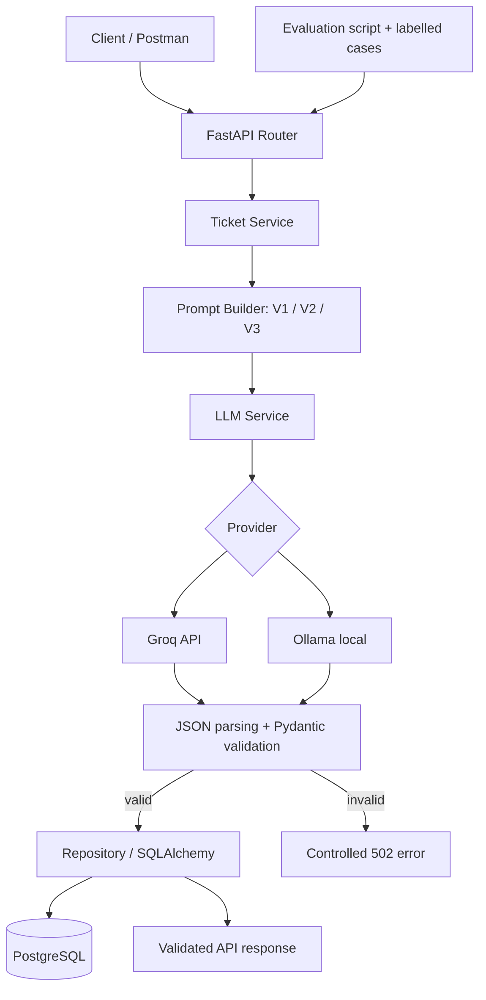

# Architecture and request flow

1. Router validates the incoming request with Pydantic.
2. Ticket service loads the requested reusable prompt version.
3. LLM service calls Groq or Ollama with a timeout and bounded retry.
4. The response is parsed as JSON and validated against the Pydantic response schema and allowed enums.
5. Validated output and provider/prompt/timing/token metadata are persisted in PostgreSQL.
6. The API returns a draft for a human agent. No customer message is sent.
7. The evaluation script sends the same fixed labelled cases through V1, V2 and V3 and writes a comparable report.
